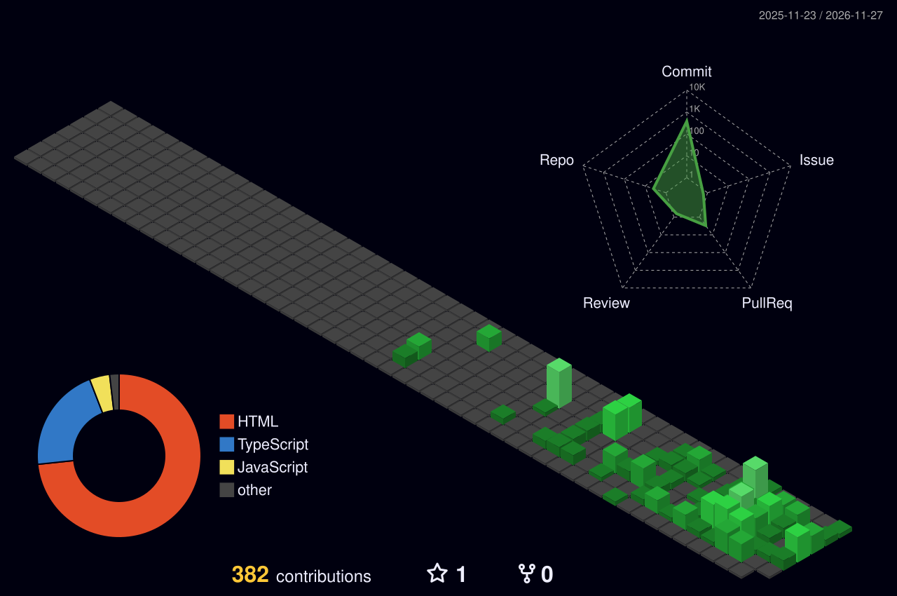

  <h1>Olá, eu sou o Anderson Correia! 👋</h1>
  <h3>Analista de Suporte de TI & Sistemas | Redes de Computadores (IFRN)</h3>
  
Especialista em sustentação de sistemas, infraestrutura de redes, monitoramento ativo (Zabbix/Grafana) e integrações corporativas via Python (Django), SQL Server (T-SQL), MySQL e API REST.

  

    
    
    
    
  

---

### 👨‍💻 Sobre Mim

- 💼 **Atuação atual:** Suporte de TI & Sistemas no **Grupo G Trigueiro** (N1/N2/N3), atuando na sustentação de sistemas web/cliente-servidor, integrações com **ERP (API REST / OAuth 2.0)**, **GLPI** e **Active Directory (LDAP/LDAPS)**.
- 🎓 **Formação & Certificações:** Graduando em **Tecnologia em Redes de Computadores (IFRN)**, **Técnico em Informática (IFRN)** e certificado **Red Hat (RH124, RH134, Python AD141)** e **Cibersegurança (Hackers do Bem / SENAI)**.
- 🛠️ **Especialidades:** Administração **Linux (RHEL) & Windows Server**, **SQL Server (T-SQL) & MySQL**, desenvolvimento **Python (Django)**, conteinerização com **Docker**, **VLANs** e monitoramento com **Zabbix, Grafana e Webhooks**.
- 📫 **Contato:** Disponível em **Natal/RN** pelo e-mail **andersonsantos.ifrn@gmail.com** ou via [LinkedIn](https://www.linkedin.com/in/andersonscorreia/).

---

### 🚀 Stack Tecnológica

#### Linguagens & Marcação

  

#### Frameworks, Bancos de Dados & Cache

  

#### Infraestrutura, Redes, DevOps & Monitoramento

  

> **Outras competências técnicas:** `SQL Server (T-SQL)` · `API REST / OAuth 2.0` · `ERP Sankhya OM` · `Active Directory (LDAP/LDAPS)` · `GLPI (ITSM)` · `Zabbix` · `Apache` · `VLANs & OpenVPN` · `Microsoft 365`

---

### 📊 Métricas & Contribuições em 3D

  

---

### 📂 Projetos e Repositórios em Destaque

| Projeto | Descrição | Tecnologias |
| :--- | :--- | :--- |
| **[gerencia](https://github.com/andersonscorreia/gerencia)** | Projeto de Gerência de Redes com instalação, configuração, documentação e monitoramento de ativos e serviços de infraestrutura. | `Shell Script` `Linux` `Redes` `Monitoramento` |
| **[aasr](https://github.com/andersonscorreia/aasr)** | Automação, configuração e sustentação avançada de serviços de rede em ambientes de servidores Linux. | `Shell Script` `Linux` `Redes` `Servidores` |
| **[api](https://github.com/andersonscorreia/api)** / **[socketTCP](https://github.com/andersonscorreia/socketTCP)** | Implementações de APIs e comunicação cliente-servidor em rede utilizando protocolo TCP/UDP em Python. | `Python` `API REST` `Sockets TCP/UDP` |

> 💡 **Destaques Corporativos (Grupo G Trigueiro):**
> - *Sistema Integrado de Administração:** Plataforma web cliente-servidor em `Python (Django 5)`, `MySQL`, `Redis` e `Docker` integrada via `API REST` e `SQL Server (T-SQL)` a um **ERP**, **Active Directory (LDAP/LDAPS)**, **ArqSign** e módulo de frota **PWA Offline-First**.
> - **Monitoramento de SLA & CRM:** Painel web em `Django` e `MySQL` para controle em tempo real de **SLA de chamados e NPS** via `API REST` e integração com **WhatsApp**.
